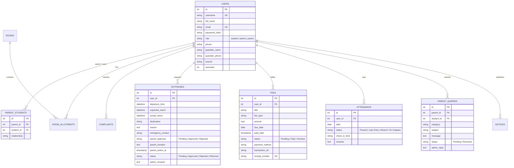

# 🏢 HostelSphere - Hostel Management Website

> **Capstone Project Synopsis Implementation**  
> **Student:** Jiyansh Sardana (Roll No: **25001003043**)  
> **Degree:** Bachelor of Technology in Computer Engineering (3rd Semester, July–Dec 2026)  
> **Supervisor:** Ms. Pratima Sharma  
> **Institution:** Department of Computer Engineering, Faculty of Informatics & Computing, J.C. Bose University of Science & Technology, YMCA, Faridabad - 121006  

---

## 📖 Project Overview

Hostels traditionally rely on scattered, inefficient channels such as physical notice boards, unofficial WhatsApp groups, and verbal communication for essential day-to-day operations. This leads to outdated information, missed announcements, lack of accountability for maintenance issues, and paper-heavy leave/outpass processes.

**HostelSphere** is a full-stack, role-based web application that centralizes all hostel workflows into a single transparent platform:
- **Generic Architecture**: Built to be adaptable to any university, college, or private hostel.
- **3-Tier Role-Based Access Control (RBAC)**: Distinct permissions and interactive portals for **Students (Residents)**, **Parents & Guardians**, and **Administrators (Chief Warden & Staff)**.
- **Two-Tier Outpass Clearance Workflow**: Student applies &rarr; Parent reviews and authorizes leave online with consent remarks &rarr; Chief Warden grants gate pass with verifiable security stamps.
- **Dynamic Real-Time Information**: Real-time announcements, daily & weekly mess dining schedules, interactive room occupancy mapping, ticketed maintenance complaints, nightly curfew roll-call, and digital fee invoicing with printable receipts.

---

## 🛠️ Technology Stack

| Layer | Technology | Details |
|---|---|---|
| **Frontend** | HTML5, CSS3, JavaScript | Responsive modern design system with CSS custom properties, cards, badges, mobile navbar, interactive payment modals, printable media styles |
| **Backend** | Python 3.14+, Flask 3.1 | Modular route handlers, session management, security filters, custom Jinja context processors |
| **Templating** | Jinja2 | Dynamic server-side rendering, inheritance layouts, date/time formatting filters |
| **Database** | SQL / SQLite3 | Relational schema with foreign keys, cascading constraints, and indexing (readily extensible to PostgreSQL / MySQL) |
| **Authentication** | Session-Based RBAC | Werkzeug cryptographic password hashing, role-protected decorators (`login_required`, `student_required`, `parent_required`, `admin_required`) |

---

## ✨ Key Modules & Capabilities

### 👨‍👩‍👦 1. Parent & Guardian Portal *(New!)*
- **Ward Executive Dashboard**:
  - Live overview of ward's profile, academic department, and semester.
  - Allotted hostel room details (Room number, block, floor, AC type, bed number).
  - Roommate directory with verified emergency contact numbers.
  - Urgent action callout banner for outpasses requiring parental authorization.
- **Outpass Approval System**:
  - Review child's departure time, return deadline, destination, and travel purpose.
  - **1-Click Parental Approval or Rejection** with custom guardian remarks.
  - Full leave history tracking with status indicators.
- **Hostel Fees & Payments**:
  - Review fee invoices (Hostel Accommodation, Mess Charges, Amenities).
  - Clear pending dues online with simulated instant payment gateway (UPI, NetBanking, Cards).
  - View & print official institutional payment receipts.
- **Curfew & Night Roll-Call Log**:
  - Daily biometric check-in log and curfew compliance (9:30 PM deadline).
  - Track 7-day attendance rate, late entry flags, and disciplinary records.
- **Parent Helpdesk & Warden Communication Desk**:
  - Submit inquiries directly to the Chief Warden (*Medical/Health, Mess Diet, Leave, Discipline, Fees*).
  - View real-time responses and resolutions from the hostel administration.

### 🎓 2. Student Portal
- **Personal Dashboard**: Instant summary of allotted room, bed number, roommates, today's 4-meal mess preview, active complaints, fee dues, attendance rate, and leave pass statuses.
- **Accommodation & Roommates Directory**: Full details of allocated room with contact records of verified room partners.
- **Maintenance & Complaints Desk**:
  - Submit tickets categorized under *Plumbing, Electrical, Wi-Fi, Furniture, Cleanliness, Other*.
  - Set priority (*Low, Medium, High, Urgent*).
  - Track live ticket progress (*Pending &rarr; In Progress &rarr; Resolved* with admin remarks).
- **Two-Tier Digital Leave & Outpass Workflow**:
  - Request gate leave with departure, expected return, destination, emergency contact, and reason.
  - Track both **Parental Consent** and **Warden Authorization** progress.
  - Automatically generate a **Printable Official Security Gate Pass** complete with dual approval verification stamps.
- **Fee Invoices & Payments**: View fee breakdown, clear outstanding dues online, and download/print official payment receipts.
- **Curfew Attendance Log**: View personal biometric check-in log, curfew status, and attendance percentages.
- **Notice Board**: Read pinned circulars and filter by category (*Urgent, General, Mess, Event, Maintenance, Rules*).
- **Mess Menu**: 7-day schedule (Monday to Sunday) for Breakfast, Lunch, Evening Snacks, and Dinner with meal timings and dietary notes.
- **Profile Settings**: Update phone number, emergency guardian details, or change password.

### 🛡️ 3. Administrator (Warden & Staff) Portal
- **Executive Operations Dashboard**:
  - Live metric widgets: Registered Residents, Beds Occupied %, Total Fees Collected, Pending Maintenance Tickets, Pending Outpasses, Pending Parent Inquiries.
  - Urgent maintenance workbench and pending outpass approval queue.
- **Outpass Review & Gate Control**:
  - View parent approval status, parent consent remarks, and authorization timestamps.
  - Grant final gate clearance or reject applications.
  - Mark student return timestamps when residents re-enter campus.
- **Hostel Fee & Billing Management**:
  - Track total billed, verified collections, and outstanding dues.
  - Issue new fee bills to individual students or in bulk to all residents.
  - Inspect generated receipts and transaction references.
- **Night Curfew & Roll-Call Management**:
  - Daily roll-call roster with date picker.
  - Mark individual student status (*Present, Late Entry, On Outpass, Absent*) with notes.
  - 1-click **"Mark Unmarked as Present"** bulk roll-call verification.
- **Parent Inquiries Desk**:
  - Review guardian messages and inquiries.
  - Respond with official warden remarks and mark queries as resolved.
- **Room Inventory & Allotment Manager**:
  - Add new rooms with block, floor, bed capacity, room type (AC/Non-AC), and monthly rent.
  - Allocate unallotted students to available beds in any room.
  - Deallocate students and automatically free beds.
- **Maintenance Complaint Dispatch**:
  - Filter tickets by status (*Pending, In Progress, Resolved, Rejected*) and category.
  - Update progress, assign technician names, and append resolution notes.
- **Announcement Publisher & Mess Schedule Editor**:
  - Publish circulars and edit weekly meal schedules.
- **Student Roster**:
  - Searchable resident registry with roll numbers, contact numbers, and guardian details.

---

## 🚀 Quick Start Guide

### Option A: Using the Automated Runner (Recommended)
```bash
./run.sh
```
This automatically verifies the virtual environment, seeds realistic demonstration data, and launches the server at `http://127.0.0.1:5001`.

### Option B: Manual Setup
1. **Activate Virtual Environment**:
   ```bash
   source venv/bin/activate
   ```
2. **Install Dependencies**:
   ```bash
   pip install -r requirements.txt
   ```
3. **Seed Database with Sample Data**:
   ```bash
   python seed_data.py
   ```
4. **Launch Application**:
   ```bash
   python app.py
   ```
5. Open your web browser at: **`http://127.0.0.1:5001`**

---

## 🔑 Demonstration Accounts

The database comes pre-populated with realistic campus records for immediate evaluation:

| Role | Username / Roll Number | Password | Notes |
|---|---|---|---|
| **Chief Warden (Admin)** | `admin` | `admin123` | Full administrative control, outpass approval, fees & roll call |
| **Parent (Mr. Rakesh Sardana)** | `parent_25001003043` | `parent123` | Linked to ward Jiyansh Sardana (has pending outpass ready to approve!) |
| **Student (Resident)** | `25001003043` | `student123` | Jiyansh Sardana (Computer Engg, Room A-101) |
| **Parent (Mr. Manoj Sharma)** | `parent_25001003044` | `parent123` | Linked to ward Rahul Sharma |
| **Student (Resident)** | `25001003044` | `student123` | Rahul Sharma (Room A-101 roommate) |
| **Student (Resident)** | `25001003045` | `student123` | Aarav Mehta (IT Dept, Room A-102) |
| **Student (Resident)** | `25001003046` | `student123` | Priya Verma (ECE Dept, Room B-101) |

*(Note: The login page also includes 1-click **Demo Quick Fill buttons** for Student, Parent, and Warden for instant testing!)*

---

## 🧪 Automated Test Suite

A complete test suite covering authentication, RBAC boundaries, parent outpass reviews, fee payments, printable receipts, night curfew attendance, parent queries, notices, and room allotments is included.

Run tests:
```bash
./venv/bin/python test_app.py
```
Expected output:
```text
Ran 17 tests in 2.2s
OK
```

---

## 🗄️ Relational Database Schema


